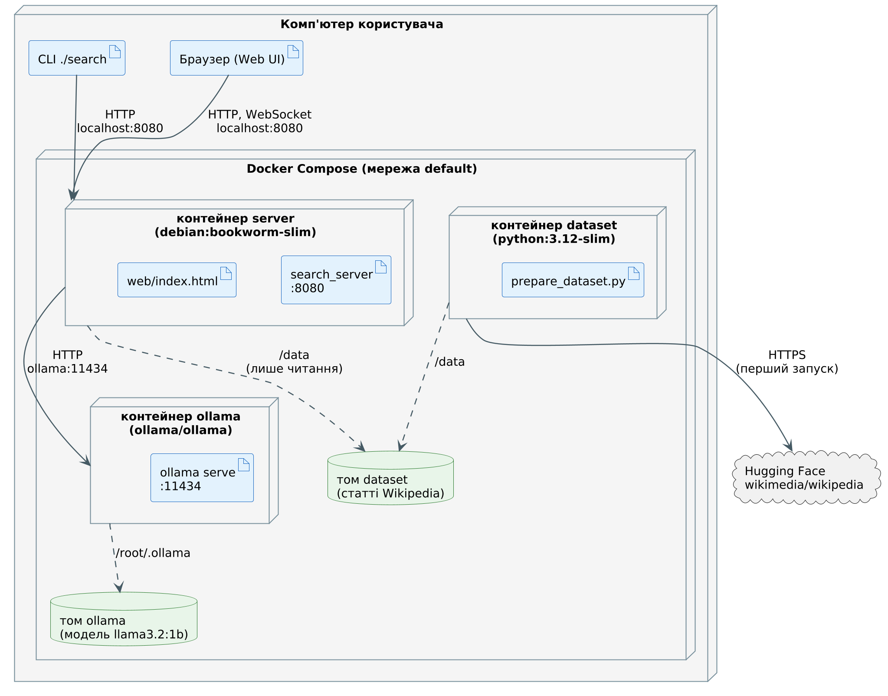

# Parallel Search Engine

Пошукова система на C++17. Вона паралельно будує інвертований індекс з текстових файлів і обслуговує кількох клієнтів одночасно. Пул потоків і потокобезпечну хеш-таблицю для індексу написано власноруч. Запит розширюється через локальну LLM (Ollama), а етапи пошуку приходять клієнту через WebSocket.

## Запуск

Потрібен Docker з Compose v2 і щонайменше 8 ГБ пам'яті для Docker. Для консольного клієнта і бенчмарків потрібен Python 3.

```bash
docker compose up --build
```

Перший запуск завантажує датасет (1,6 ГБ) і модель `llama3.2:1b` (1,3 ГБ), далі вони беруться з томів. Сервер слухає порт 8080.

Після старту індекс порожній. Побудова у 8 потоків:

```bash
curl -X POST http://localhost:8080/api/index -d '{"threads": 8}'
```

## Пошук

Веб-сторінка відкривається на http://localhost:8080.

З консолі потрібен лише Python 3. На Windows без WSL команда починається з `python search`.

```bash
./search "moon landing"
```

Клієнт надсилає запит у `/ws/search` і друкує розширені терміни, а потім результати з оцінкою, шляхом до файлу й уривком. Адресу сервера задає `--url` або змінна `SEARCH_URL`, за замовчуванням `http://localhost:8080`.

Через REST:

```bash
curl -X POST http://localhost:8080/api/search -d '{"query": {"text": "moon landing", "mode": "keyword"}}'
```

## Дані

Англійська Wikipedia, дамп 20231101 з [wikimedia/wikipedia](https://huggingface.co/datasets/wikimedia/wikipedia), шарди 00016, 00037 і 00039, ліцензія CC BY-SA 3.0. Одна стаття в одному файлі: 468 864 файли, 2,63 ГБ. Їх готує сервіс `dataset` у томі `dataset`.

Сервер рекурсивно індексує всі файли з теки `DATA_DIR`, у контейнері це `/data`. Статті лежать як `/data/wikipedia/NNNN/<назва>.txt`, по 1000 у теці. Кожен файл у UTF-8 містить назву статті, порожній рядок і текст.

Перевірка обсягу:

```bash
docker compose run --rm dataset python check_dataset.py /data
```

## Архітектура



Решта діаграм (варіанти використання, класи, послідовності) лежить у [docs/uml](docs/uml).

## Тести

Тест на гонки для індексу і пулу потоків працює під ThreadSanitizer. Якщо гонок немає, він друкує `OK`.

```bash
docker build --target test -t search-test .
docker run --rm --security-opt seccomp=unconfined search-test
```

Тестові запити з очікуваними й фактичними результатами наведено в [docs/test_cases.md](docs/test_cases.md).

## Бенчмарки

Потрібні Python 3 і `pip install -r bench/requirements.txt`. Сервер має працювати, а для пошуку індекс має бути побудований.

```bash
python bench/bench_index.py --threads 1 2 4 8 16 32
python bench/bench_search.py
```

CSV і графіки записуються в `bench/results/`.

## API

| Ендпоінт | Тіло запиту | Відповідь 200 |
|---|---|---|
| `GET /api/health` | - | `{"status": "ok", "ollama": true}` |
| `POST /api/index` | `{"threads": 4}` | `{"status": "ok", "documents_indexed": 2000, "time_ms": 1234}` |
| `POST /api/search` | `{"query": {"text": "...", "mode": "keyword"}}` | `{"results": [{"doc_id": "...", "score": 0.95, "snippet": "..."}], "time_ms": 56}` |
| `GET /api/stats` | - | `{"documents": 2000, "index_build_time_ms": 1234, "threads_used": 4}` |

`POST /api/search` приймає і `{"query": "...", "mode": "keyword"}`. Інших режимів, крім `keyword`, немає.

WebSocket `/ws/search` приймає `{"query": "..."}` і на кожен запит відповідає трьома повідомленнями. В одному з'єднанні можна надіслати кілька запитів.

```json
{"stage": "query_expansion", "data": {"original": "...", "expanded_terms": ["..."]}}
{"stage": "keyword_search", "data": {"results": [...], "time_ms": 12}}
{"stage": "done"}
```

| Поле | Тип | Значення |
|---|---|---|
| `threads` | integer | кількість потоків індексації, від 1 до 256 |
| `query` | string або object | текст запиту, або `{"text": string, "mode": string}` у `/api/search` |
| `mode` | string | лише `"keyword"` |
| `status` | string | `"ok"` |
| `ollama` | boolean | чи відповідає Ollama |
| `documents_indexed`, `documents` | integer | кількість документів в індексі |
| `time_ms`, `index_build_time_ms` | integer | час у мілісекундах |
| `threads_used` | integer | потоки останньої індексації, 0 до першої |
| `results` | array | до 10 результатів, найкращий перший |
| `doc_id` | string | шлях до файлу відносно `/data` |
| `score` | number | оцінка TF-IDF |
| `snippet` | string | уривок тексту навколо знайденого терміна |
| `stage` | string | `query_expansion`, `keyword_search` або `done` |
| `original` | string | запит без змін |
| `expanded_terms` | array of string | до 8 термінів від LLM, порожній, якщо Ollama недоступна |
| `error` | string | опис помилки |

Помилки мають вигляд `{"error": "..."}`: 400 для некоректного запиту, 404 для невідомого шляху, 409 якщо індексація вже триває, 500 для внутрішньої помилки. Некоректне повідомлення у WebSocket закриває з'єднання.

## Структура

```
src/       сервер на C++
web/       веб-сторінка
search     консольний клієнт
scripts/   підготовка й перевірка датасету
tests/     тест на гонки
bench/     бенчмарки
docs/      UML-діаграми і тестові запити
```
